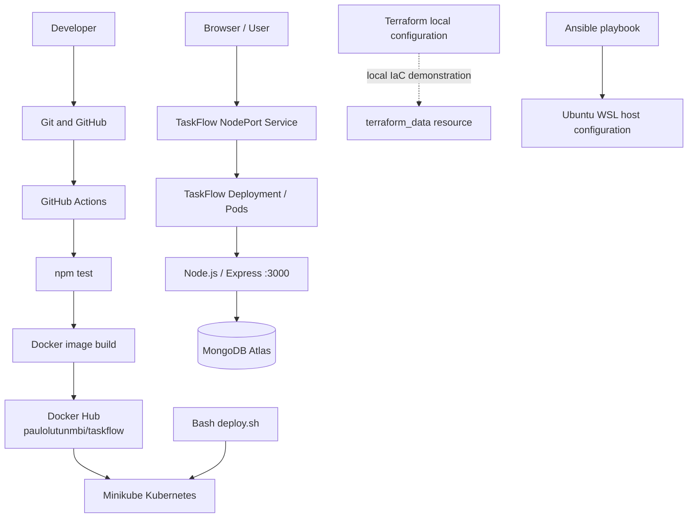

# TaskFlow — DevOps Capstone Deployment

TaskFlow is a lightweight, responsive shared task board built with Node.js, Express, and MongoDB Atlas. This repository demonstrates a DevOps delivery workflow: source control, automated testing, containerization, image publishing, infrastructure configuration, configuration management, Kubernetes deployment, and deployment automation.

> **Privacy notice:** TaskFlow has no user accounts or authentication. Visitors to the same deployment share the same tasks and can create, edit, complete, or delete them. Do not enter passwords, contact details, or other sensitive information.

## 1. Project overview

- **Application:** Shared task board with create, read, update, delete, filtering, and search.
- **Backend:** Node.js and Express.
- **Database:** MongoDB Atlas through Mongoose.
- **Container:** Docker image published to Docker Hub.
- **CI/CD:** GitHub Actions runs automated tests and builds/publishes the image on pushes to `main`.
- **Orchestration:** Kubernetes manifests deployed to a local Minikube cluster.
- **Infrastructure as Code:** Terraform local demonstration using the built-in `terraform_data` resource. Azure resource creation is intentionally not enabled.
- **Configuration management:** Ansible playbook executed against the local Ubuntu WSL environment.
- **Deployment automation:** Bash script applies Kubernetes manifests and waits for rollout completion.

## 2. Architecture



**Deployment flow:** code is committed and pushed to GitHub; GitHub Actions installs dependencies, runs tests, builds the Docker image, and publishes it to Docker Hub for pushes to `main`. The Kubernetes deployment runs the published image in Minikube. The Bash deployment script applies the manifests to the cluster. The application connects to MongoDB Atlas.

## 3. Technology stack

| Area | Technology |
|---|---|
| Application runtime | Node.js 24 |
| Backend | Express |
| Database | MongoDB Atlas, Mongoose |
| Version control | Git, GitHub |
| Automated tests | Node.js built-in test runner |
| Containerization | Docker |
| Image registry | Docker Hub |
| Infrastructure as Code | Terraform |
| Configuration management | Ansible |
| Orchestration | Kubernetes, Minikube |
| CI/CD | GitHub Actions |
| Automation | Bash |
| Local Linux environment | Ubuntu on WSL |

## 4. Repository structure

```text
devops-deployment-pipeline/
├── .github/
│   └── workflows/
│       └── ci-cd.yml
├── ansible/
│   ├── inventory.ini
│   └── playbook.yml
├── docs/
│   ├── architecture.md
│   ├── deployment-guide.md
│   ├── troubleshooting.md
│   ├── lessons-learned.md
│   └── demo-guide.md
├── kubernetes/
│   ├── namespace.yaml
│   ├── deployment.yaml
│   ├── service.yaml
│   └── hpa.yaml
├── scripts/
│   └── deploy.sh
├── src/
│   ├── app.js
│   ├── server.js
│   ├── db.js
│   ├── store.js
│   ├── models/
│   └── routes/
├── public/
│   ├── index.html
│   ├── css/
│   └── js/
├── terraform/
│   └── main.tf
├── test/
├── .dockerignore
├── .env.example
├── .gitignore
├── Dockerfile
├── package.json
├── package-lock.json
└── README.md
```

## 5. Run locally

### Prerequisites

- Node.js 24 (Node.js 20+ may work, but the project was tested with Node.js 24)
- npm
- A MongoDB Atlas cluster and database user
- Git

### Configure environment

Copy the example file and edit the local `.env` file:

```bash
cp .env.example .env
```

Set at least:

```dotenv
PORT=3000
NODE_ENV=development
MONGODB_URI=<your-mongodb-atlas-connection-string>
MONGODB_DATABASE=taskflow
```

Do not commit `.env`. The repository `.gitignore` excludes it. Never paste credentials into issues, screenshots, reports, or public logs.

### Install and start

```bash
npm ci
npm start
```

Open `http://localhost:3000`.

### Run tests

```bash
npm test
```

The recorded local test run completed with **49 tests passed across 14 suites, with zero failures**. Run the command again before submission and retain the current terminal or Actions result as evidence.

## 6. Docker

The Dockerfile uses `node:24-bookworm-slim`, installs production dependencies, runs the app as the non-root `node` user, exposes port 3000, and starts the application with `npm start`.

Build and run locally:

```bash
docker build -t taskflow:local .
docker run --rm -p 3000:3000 --env-file .env taskflow:local
```

The published Docker Hub repository is:

- `paulolutunmbi/taskflow`
- `paulolutunmbi/taskflow:latest`
- A commit-SHA tag is also produced by the GitHub Actions workflow.

Do not put Docker Hub credentials in the Dockerfile or repository. GitHub Actions uses repository secrets named `DOCKERHUB_USERNAME` and `DOCKERHUB_TOKEN`.

## 7. Kubernetes deployment

The Kubernetes resources are stored in `kubernetes/`:

- `namespace.yaml` creates the `taskflow` namespace.
- `deployment.yaml` defines the TaskFlow pods, container port, environment Secret reference, resource requests/limits, and health probes.
- `service.yaml` exposes the deployment through a NodePort service.
- `hpa.yaml` configures a Horizontal Pod Autoscaler with a minimum of 2 replicas, maximum of 5 replicas, and a target average CPU utilization of 50%.

Apply the resources manually:

```bash
kubectl apply -f kubernetes/namespace.yaml
kubectl apply -f kubernetes/deployment.yaml
kubectl apply -f kubernetes/service.yaml
kubectl apply -f kubernetes/hpa.yaml
kubectl rollout status deployment/taskflow -n taskflow
```

Or use the deployment script from Ubuntu WSL:

```bash
chmod +x scripts/deploy.sh
./scripts/deploy.sh
```

The script uses `kubectl.exe` and converts WSL paths with `wslpath -m` so Windows `kubectl.exe` can read the manifest paths.

Inspect the deployment:

```bash
kubectl get nodes
kubectl get all -n taskflow
kubectl get hpa -n taskflow
kubectl describe deployment taskflow -n taskflow
kubectl logs deployment/taskflow -n taskflow
```

To obtain a local service URL:

```bash
minikube service taskflow-service -n taskflow --url
```

Keep the terminal running if Minikube asks it to maintain a service tunnel.

The application exposes `/health`, `/health/live`, and `/health/ready`. Kubernetes uses the liveness and readiness endpoints configured in the deployment manifest.

## 8. Terraform

Terraform configuration is in `terraform/main.tf`. The submitted configuration uses Terraform's built-in `terraform_data` resource as a **local demonstration** of the Terraform workflow. It does not provision Azure infrastructure or incur cloud charges.

Run:

```bash
terraform -chdir=terraform fmt -check
terraform -chdir=terraform init -backend=false
terraform -chdir=terraform validate
terraform -chdir=terraform plan
```

If demonstrating an apply, inspect the plan first and apply only the local configuration:

```bash
terraform -chdir=terraform apply
```

The earlier local demonstration was applied and subsequently destroyed. Re-run the commands against the final committed configuration and capture fresh output for assessment. Do not enable the commented Azure example unless cloud access, budget, and instructor approval are available.

## 9. Ansible

Ansible files:

- `ansible/inventory.ini` targets `localhost` using a local connection in Ubuntu WSL.
- `ansible/playbook.yml` ensures `curl` is installed, creates `/opt/taskflow`, and writes an Ansible-managed information file.

Run from the project directory in WSL:

```bash
ansible-playbook -i ansible/inventory.ini ansible/playbook.yml --syntax-check
sudo ansible-playbook -i ansible/inventory.ini ansible/playbook.yml
```

This demonstrates configuration management on the local WSL host. It is **not** configuration of a remote cloud VM. An idempotent repeat should report no further changes when the machine is already in the desired state.

## 10. GitHub Actions CI/CD

Workflow: `.github/workflows/ci-cd.yml`.

On pushes to `main`, the workflow:

1. Checks out the repository.
2. Sets up Node.js 24.
3. Installs dependencies with `npm ci`.
4. Runs `npm test`.
5. Sets up Docker Buildx.
6. Logs in to Docker Hub using GitHub repository secrets.
7. Builds and pushes `paulolutunmbi/taskflow:latest` and a commit-SHA tag.

For pull requests targeting `main`, tests and the Docker build run, but the image is not pushed. The workflow builds and publishes the image; Kubernetes deployment is performed separately with the deployment script.

The recorded workflow run completed successfully. Recheck the latest run in the repository's **Actions** tab before submission.

## 11. Application features and API

TaskFlow is an unauthenticated shared task board. Tasks are stored in MongoDB Atlas and are shared by all visitors to the same deployment.

Features include task creation, editing, completion, deletion, status and priority filtering, keyword search, empty-state handling, database error handling, and health checks.

### Health endpoints

| Method | Endpoint | Purpose |
|---|---|---|
| GET | `/health` | Application health and uptime metadata |
| GET | `/health/live` | Liveness check |
| GET | `/health/ready` | Readiness check; returns unavailable when the database is disconnected |

### Task endpoints

| Method | Endpoint | Purpose |
|---|---|---|
| GET | `/api/tasks` | List tasks; supports status, priority, and search filters |
| GET | `/api/tasks/:id` | Retrieve one task |
| POST | `/api/tasks` | Create a task |
| PUT | `/api/tasks/:id` | Update a task |
| DELETE | `/api/tasks/:id` | Delete a task |

Task fields include title, description, priority (`low`, `medium`, `high`), status (`todo`, `in-progress`, `completed`), and required display name (`createdBy`).

## 12. Security and limitations

- The application currently has no authentication or per-user authorization. Anyone who can access the board can interact with shared tasks.
- Store MongoDB credentials in environment variables or Kubernetes Secrets; never commit them.
- The Kubernetes Secret referenced by the deployment must be created in the `taskflow` namespace using the deployment environment's own secure values. Do not include Secret values in this repository.
- The local Terraform demonstration does not create cloud infrastructure.
- Ansible targets the local WSL host, not a remote server.
- GitHub Actions publishes the image but does not automatically deploy it to Kubernetes.
- Minikube is a local Kubernetes environment, not a production cloud cluster.

## 13. Supporting documentation

See the `docs/` directory:

- [Architecture](docs/architecture.md)
- [Deployment guide](docs/deployment-guide.md)
- [Troubleshooting report](docs/troubleshooting.md)
- [Lessons learned and future improvements](docs/lessons-learned.md)

