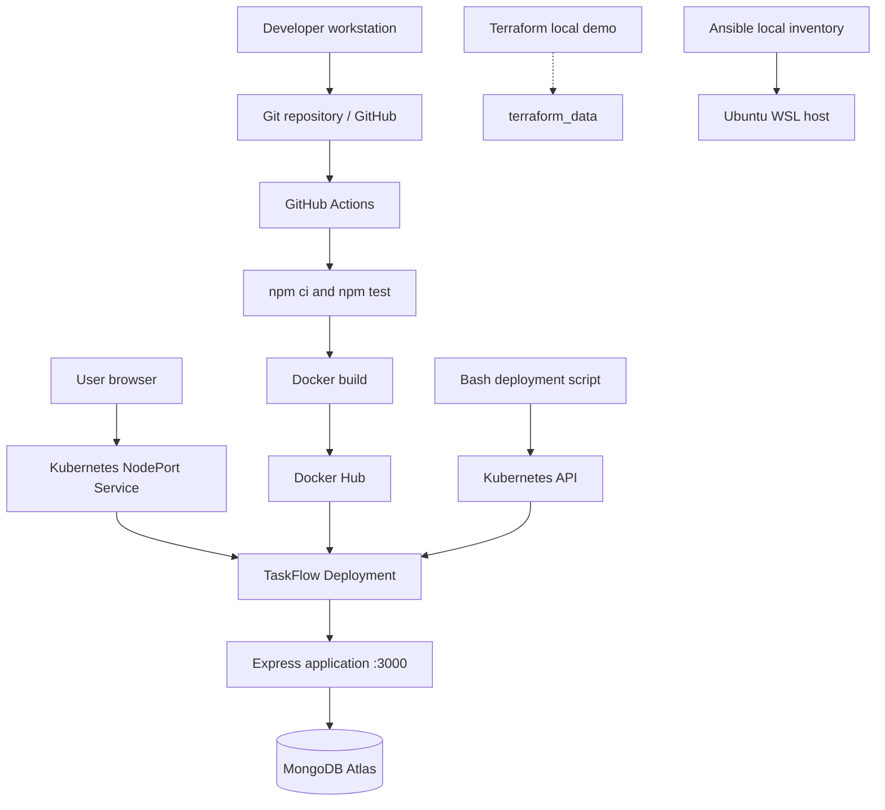

# TaskFlow Architecture

## Overview

TaskFlow is a Node.js/Express web application backed by MongoDB Atlas. It is packaged as a Docker image, published to Docker Hub by GitHub Actions, and run as a Kubernetes Deployment in a local Minikube cluster.

## Logical architecture

## Component responsibilities

| Component | Responsibility |
|---|---|
| Git/GitHub | Source control, collaboration history, and workflow trigger |
| GitHub Actions | Dependency installation, automated tests, Docker build and image publishing |
| Docker | Packages the application and production dependencies |
| Docker Hub | Stores the versioned TaskFlow container image |
| Terraform | Demonstrates an Infrastructure-as-Code workflow locally |
| Ansible | Applies repeatable configuration to the local WSL host |
| Minikube/Kubernetes | Runs and manages TaskFlow pods locally |
| Deployment/Service/HPA | Defines desired replicas, networking, and CPU-based scaling policy |
| MongoDB Atlas | Persistent task data store |

## Request path

1. A visitor opens the TaskFlow service URL.
2. The Kubernetes Service forwards traffic to a TaskFlow pod on container port 3000.
3. Express serves the frontend and handles API requests.
4. Task operations are persisted in MongoDB Atlas.
5. Readiness and liveness endpoints allow Kubernetes to monitor application availability.

## CI/CD path

1. A push to `main` triggers the workflow.
2. GitHub Actions checks out the code and sets up Node.js.
3. `npm ci` installs locked dependencies and `npm test` runs the automated suite.
4. Docker Buildx builds the image.
5. On a push to `main`, GitHub Actions authenticates to Docker Hub using repository secrets and publishes `latest` and the commit-SHA tag.
6. Kubernetes deployment is a separate operation initiated by the deployment script; the workflow does not automatically deploy to Minikube.

## Scope and limitations

The Kubernetes cluster and Ansible target are local environments. Terraform demonstrates local resource lifecycle management and does not provision Azure resources. MongoDB Atlas is an external managed database. The application has no authentication and is intended as a capstone demonstration, not a secure multi-tenant production service.
